# pyODM

Observers-based Data Modeling (ODM): a lightweight algorithm that extracts
low-density data models (*coresets*) which keep the internal structure of a
data set, for clustering, classification and anomaly detection.

Contact: Fares Meghdouri - fares.meghdouri@tuwien.ac.at

Paper: "Modeling Data with Observers"
```
@article{meghdouri2022modeling,
  title={Modeling data with observers},
  author={Meghdouri, Fares and Iglesias V{\'a}zquez, F{\'e}lix and Zseby, Tanja},
  journal={Intelligent Data Analysis},
  volume={26},
  number={3},
  pages={785--803},
  year={2022},
  publisher={IOS Press}
}
```

## Installation

pyodm needs only `numpy`, `scipy` and `joblib`; the private `dSalmon` M-Tree
package the original code depended on is **no longer required** (the k-NN cores
now ship with the package, see below).

Recommended: a private virtual environment.

```bash
python3 -m venv .venv
source .venv/bin/activate          # Windows: .venv\Scripts\activate
pip install -r requirements.txt     # runtime + plotting + tests
pip install -e .                    # install pyodm itself (editable)
```

or, without cloning:

```bash
pip install git+https://github.com/CN-TU/pyodm
```

Verify the installation:

```bash
python -c "import pyodm; print(pyodm.__version__)"
python -m pytest tests -q           # optional, needs pytest
```

## Usage

Many parameters can be adjusted to build a representative model; refer to the
paper for the details.

### Create a model

```python
import pyodm
import numpy as np

# create a new model with default parameters
model = pyodm.ODM(random_state=1)

# read the data
X = np.load('my_dataset.npy')          # or pandas.read_csv('my_dataset.csv').values

# model the data
model.fit(X)

# access the coreset
print(model.observers)                 # observer locations, shape (n_observers, n_features)
print(model.population)                # number of points assigned to each observer
print(model.radius)                    # final radius of each observer
```

### k-NN cores

`core=` selects the index used to find the closest observer:

| core | implementation | notes |
|------|----------------|-------|
| `'m-tree'` (default) | dynamic metric tree (`pyodm/trees/mtree.py`) | the structure used in the paper; supports any metric, including callables |
| `'kd-tree'` | `scipy.spatial.cKDTree` with lazy deletions and rebuilds (`pyodm/trees/kdtree.py`) | fastest for `euclidean`/`manhattan`/`chebyshev` |
| `'brute'` | exact linear scan (`pyodm/trees/brute.py`) | reference implementation, handy for tiny models |

All cores are exact and return identical models for the same data and seed.

```python
fast = pyodm.ODM(core='kd-tree', random_state=1)
general = pyodm.ODM(core='m-tree', metric='manhattan', random_state=1)
```

### Outlierness scores and anomaly detection

```python
X_test = np.load('my_test_dataset.npy')

# outlierness scores (higher = more outlying)
scores = model.outlierness(X_test)

# binary labels using a contamination threshold
predictions = model.predict(X_test, contamination=0.1)
```

`O` (number of nearest observers) and `mode` (`median`, `mean`, `max`, `min`,
`sum`) control how the scores are aggregated:

```python
scores = model.outlierness(X_test, O=3, mode='mean')
```

### Points labeling

```python
# id of the closest observer for each test point (indexes model.observers)
predicted_labels = model.labels(X_test)
```

### Observers trajectories (animations)

```python
model = pyodm.ODM(track_history=True, random_state=1).fit(X)
frames, positions, radii, alive = model.trajectories(n_frames=120)
```

`positions` has shape `(n_frames, n_observers, n_features)` and contains the
observer positions at each sampled iteration (`NaN` before an observer is
born); `alive` is the corresponding boolean mask. See
[`examples/animate_observers.py`](examples/animate_observers.py).

### Get parameters

```python
model.get_params()      # dictionary of the current parameters
```

## Visual examples

Observer movements over synthetic 2-D data sets (one animation per data set,
generated by `examples/animate_observers.py`; the static overview is shown,
click the GIF/MP4 links to play the animation):

| data set | animation | overview |
|----------|-----------|----------|
| Eight Gaussian blobs | [GIF](animations/eight_blobs.gif) / [MP4](animations/eight_blobs.mp4) | 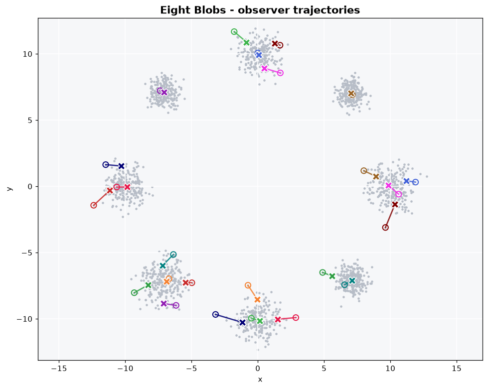 |
| Clusters with very different density | [GIF](animations/variable_density.gif) / [MP4](animations/variable_density.mp4) | 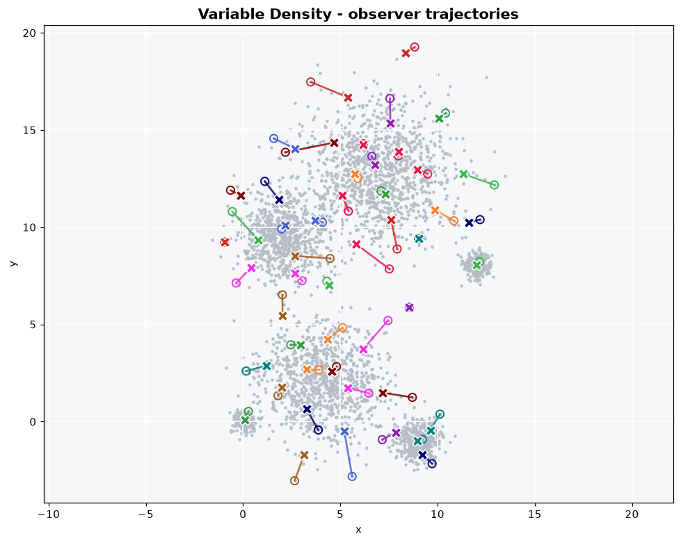 |
| Concentric rings | [GIF](animations/concentric_rings.gif) / [MP4](animations/concentric_rings.mp4) | 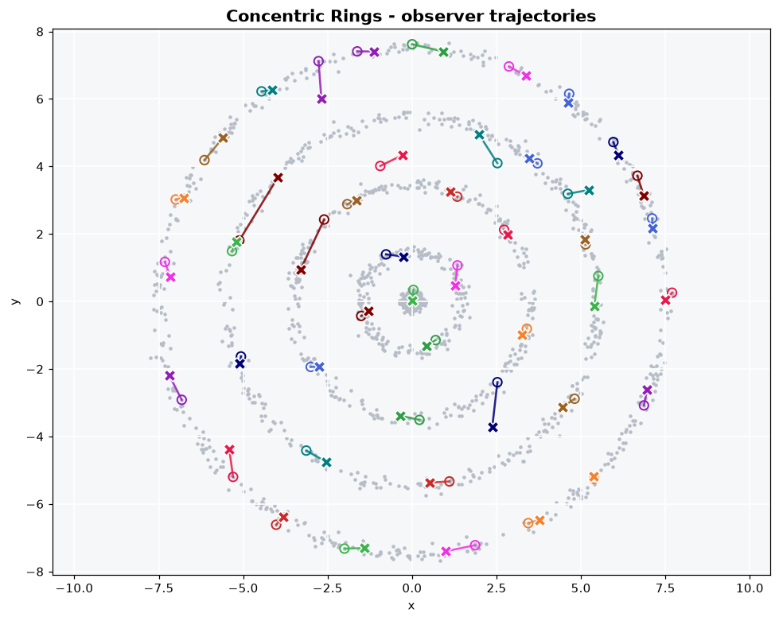 |
| Elongated overlapping clusters | [GIF](animations/anisotropic_overlapping.gif) / [MP4](animations/anisotropic_overlapping.mp4) | 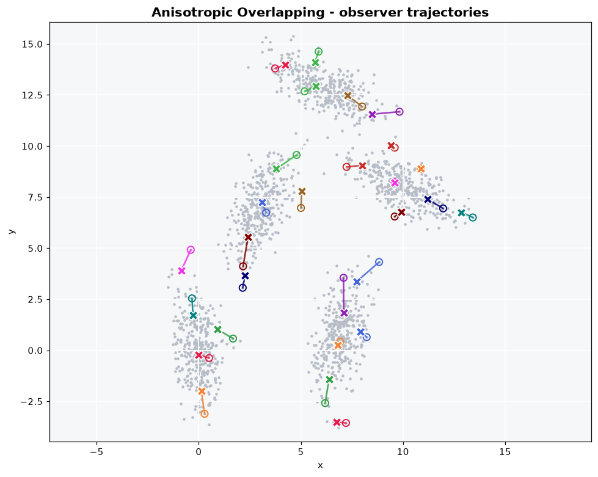 |
| Six crescent-shaped clusters | [GIF](animations/crescents.gif) / [MP4](animations/crescents.mp4) | 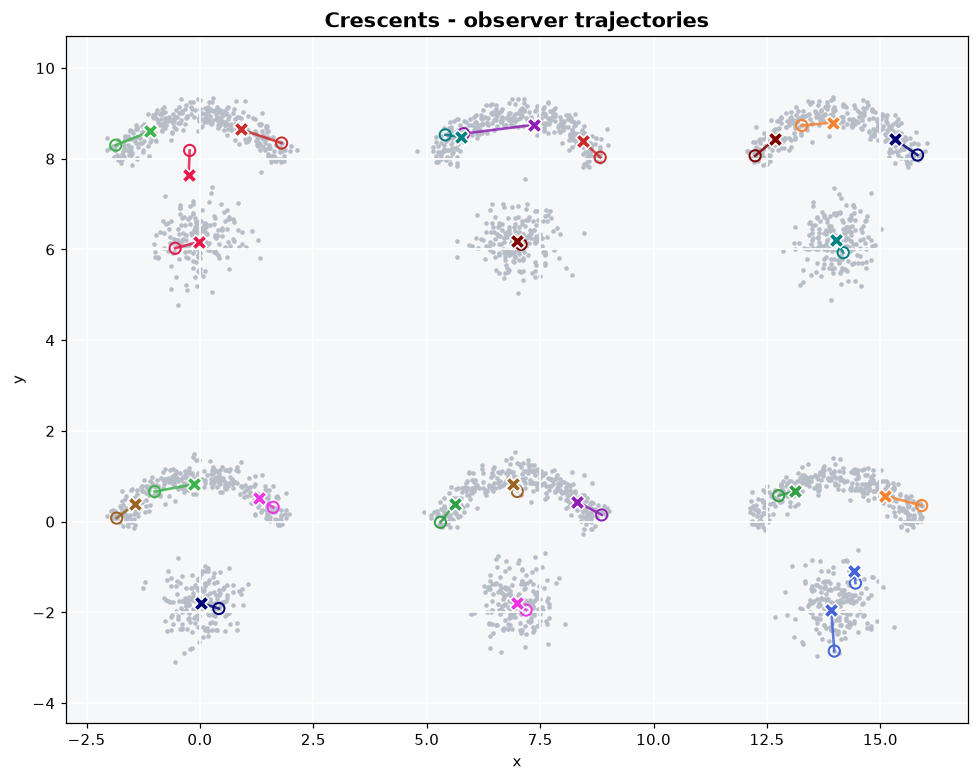 |
| Dense islands in uniform noise | [GIF](animations/islands_in_noise.gif) / [MP4](animations/islands_in_noise.mp4) | 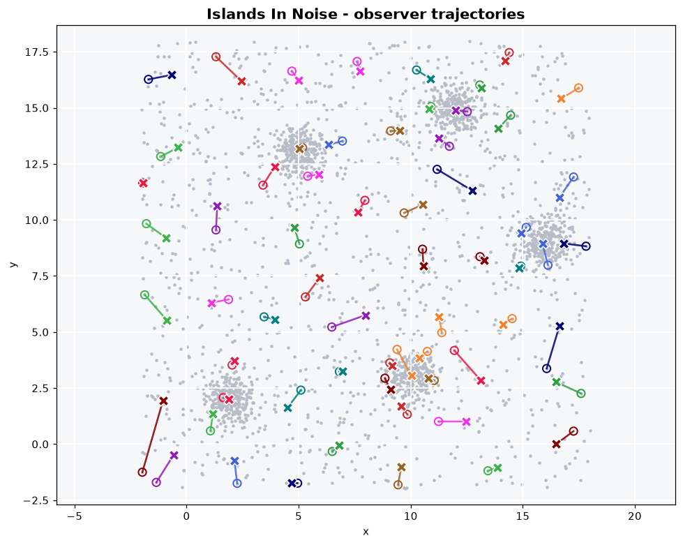 |
| Three interleaved spiral arms | [GIF](animations/spiral_arms.gif) / [MP4](animations/spiral_arms.mp4) | 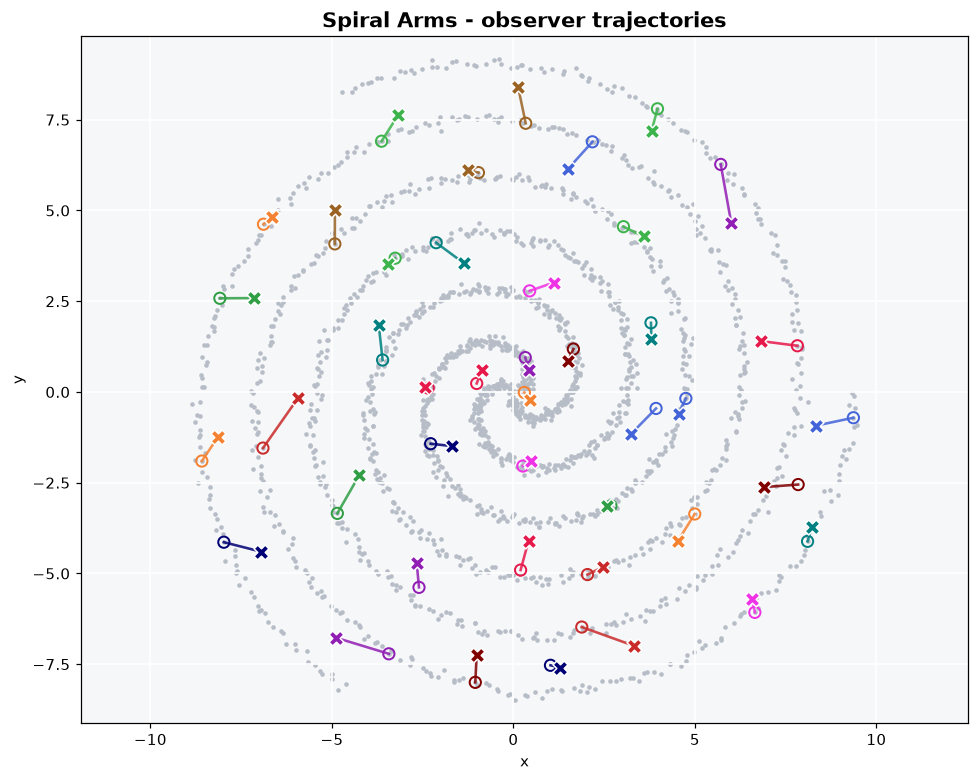 |

Legend: grey dots are data points, hollow circles mark where observers were
born, the coloured **X** markers are the current observer positions, the
coloured trails are the paths they travelled and the translucent discs show
their current radius.

Earlier stills from the paper:

Example1: Three datasets in which datapoints are represented in gray and the
ODM model in red, each with a different configuration.
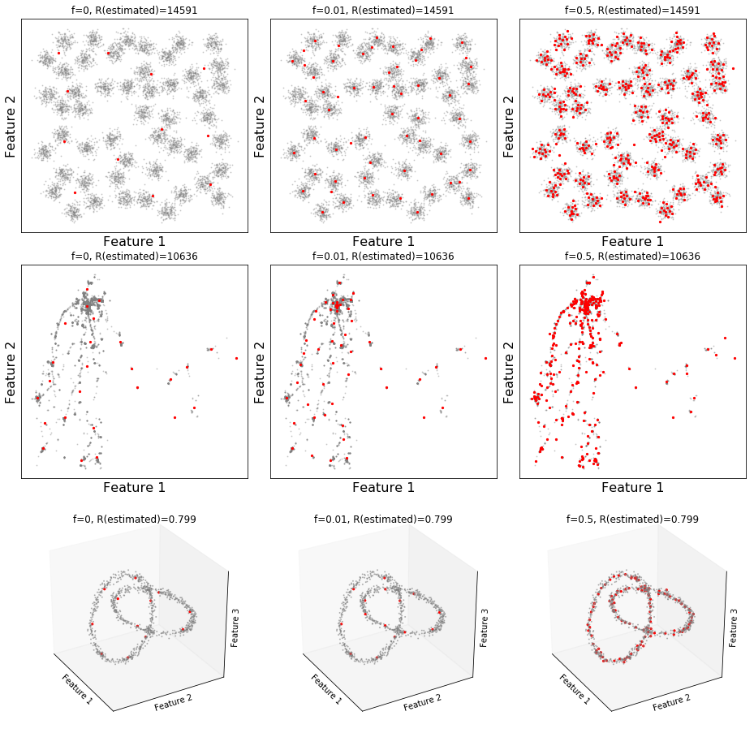

Example2: Convergence path of an observer.
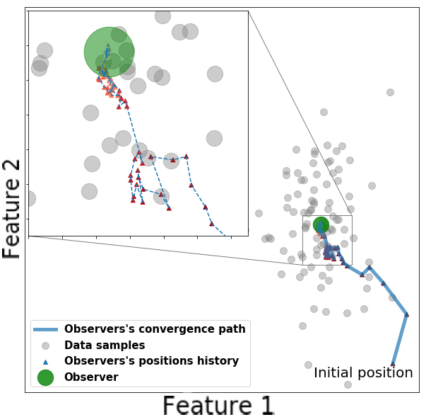

Example3: Two clusters datasets with two observers.
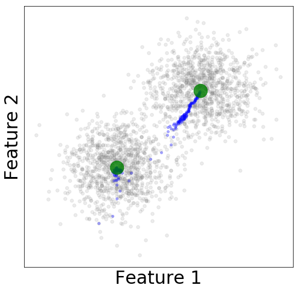

Example4: Five clusters datasets with six observers.
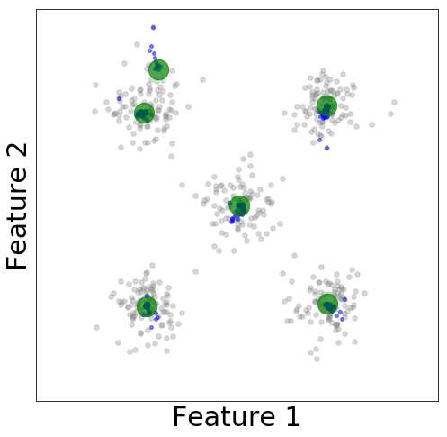

## Bug fixes

The original implementation had several defects (a hard dependency on a private
package, `ValueError` from float `np.array_split` sections, an `AttributeError`
in `get_params`, corrupted arrays when `m` exceeded the number of observers, an
unused `alpha`, a broken `_shuffle` with labels, silent model mutation in
`predict`, ...). See [BUG_FIXES.md](BUG_FIXES.md) for the full list and the
corresponding regression tests in [`tests/`](tests).

## Repository layout

```
pyodm/
  odm.py           # the ODM estimator
  _utils.py        # validation / RNG helpers
  trees/           # k-NN cores: m-tree, kd-tree, brute force
tests/             # pytest suite (algorithm + index regression tests)
examples/
  datasets.py              # synthetic 2-D data sets
  animate_observers.py     # renders the animations below
animations/        # generated GIF/MP4/PNG + data and parameters per data set
experiements/      # original paper experiment scripts
```
